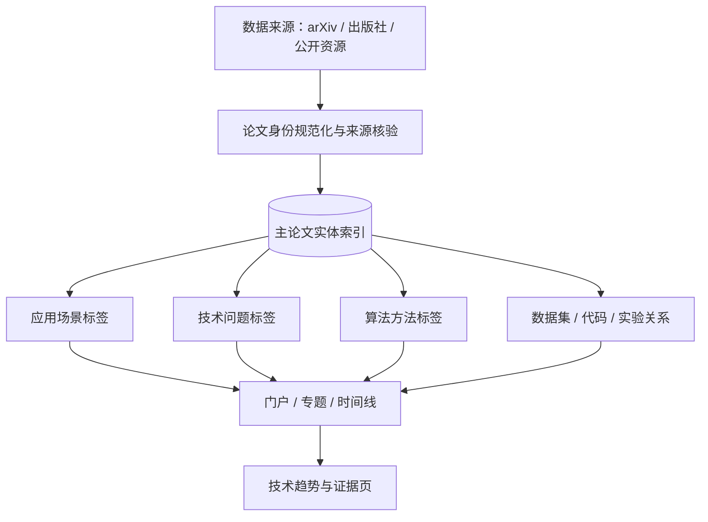

# Knowledge Architecture v1 · 内容组织与迁移规范

> 2026-11-14 第一阶段：**非破坏性信息架构升级**。旧专题、论文时间线、论文索引和每日自动化工作流保留原路径；本阶段不宣称已经完成全量 DOI 去重、论文迁移或趋势自动生成。

## 目标

一个论文实体可关联多个应用场景、问题和算法方法。页面是索引的不同视图，而不是另一个需要手动维护的论文数据库。



## 四个导航维度

- **应用场景**：DAS、泄漏、改装排气、ASD、SED；一个工作可以属于多个场景。
- **技术问题**：OOD、域泛化、标签噪声、少样本、持续学习、低 SNR、校准；不要把失效模式误写成方法分类。
- **算法方法**：基础模型、检索/表征、跨模态技术借鉴；方法不等于业务效果。
- **研究资产**：主索引、arXiv 数据、开源代码、数据集、复现、趋势、行业动态。

规范导航：`resources/research-taxonomy.json`，交互入口：`portal/index.html`。

## 待逐步统一的数据实体

- `paper_id`：优先 DOI（规范化）或 arXiv ID；两者缺失时暂用稳定临时 ID，并维护 aliases。
- `identity_status`：`candidate` / `bibliography_verified` / `fulltext_verified`。
- `links`：官方主页、开放全文、代码和私人来源必须分字段；**公共站点不得输出私人 Drive 链接**。
- `application_ids`、`problem_ids`、`method_ids`：数组而非唯一目录归属。
- `evidence_level`：A（直接实验）/ B（可比性证据）/ C（背景）/ H（假设）。
- `reproduction_status`：未开始、待复现、完成复现、业务验证；作者报告效果与本地复现必须区分。
- `trend_claim_ids`：论文只提供具体主张的支持/反证引用，不能自动将“新增论文”判定为“新范式”。

## 迭代边界

**Phase 1（本 PR）：** 新增交互门户、统一导航 JSON、校验与维护文档；在 README 增加新入口。现有索引照常运转。

**Phase 2：** 将现有 `paper-master-index.json` 与 `arxiv-cs-sd/papers.json` 做只读身份比对与可追溯映射；输出去重报告和人工复核清单，不覆盖旧库。

**Phase 3：** 定义唯一论文实体库与 JSON Schema；生成各专题精选视图、跨标签检索和趋势引用；校验链接与证据等级。需确保原有链接兼容。

**Phase 4：** 将企业动态/复现实验关系化，建立自动生成器、离线索引和 GitHub Pages 构建；自动化更新经 CI 通过后再合并。

## 迁移验收条件

1. 所有旧目录和已有 URL 继续可访问。
2. 同一 DOI/arXiv 在规范库只有一个实体，但可关联多个专题。
3. 每一趋势保留原始来源、论证边界、支持与反证、状态时间戳。
4. 自动构建输出可复现，不能修改论文作者原始报告数值。
5. 不把文件名去重的 2,145 条误称为身份级唯一论文；不与 arXiv 6,984 条直接相加。
6. 外部链接与私人文件来源明确隔离，避免泄露企业/个人云盘访问路径。

## 本地预览与检查

```bash
python3 scripts/validate_catalog.py
python3 scripts/validate_research_taxonomy.py
python3 scripts/preview_timelines.py
# 访问本地服务的 /portal/ 地址
```

注意：直接双击 `portal/index.html` 通常受浏览器 `file://` 同源策略限制，需 HTTP 服务；GitHub Pages 部署前需检查站点配置。
